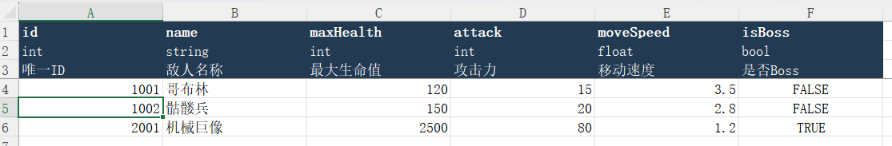
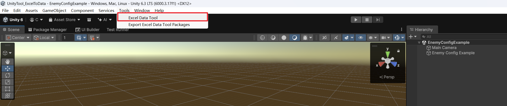
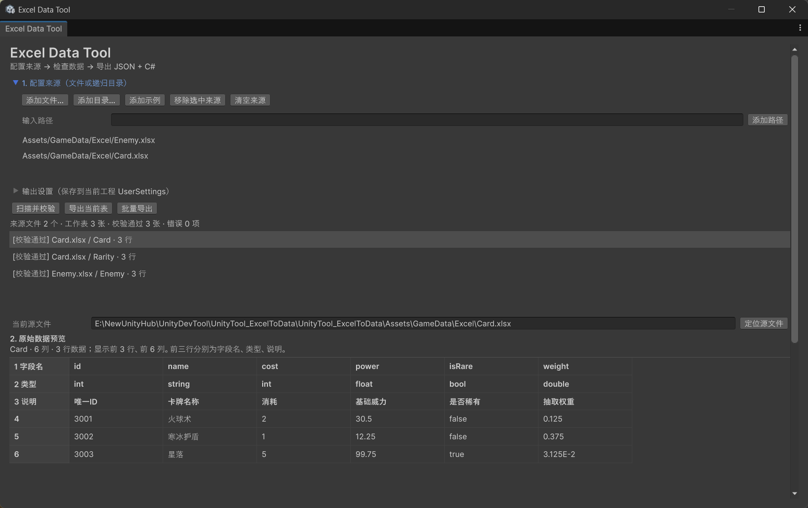
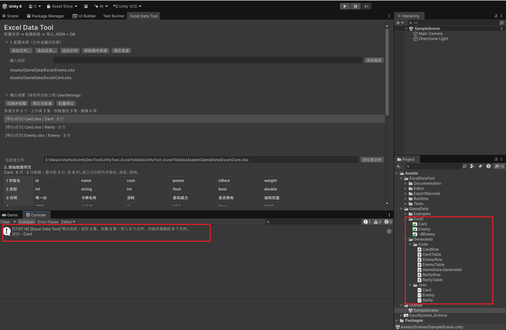
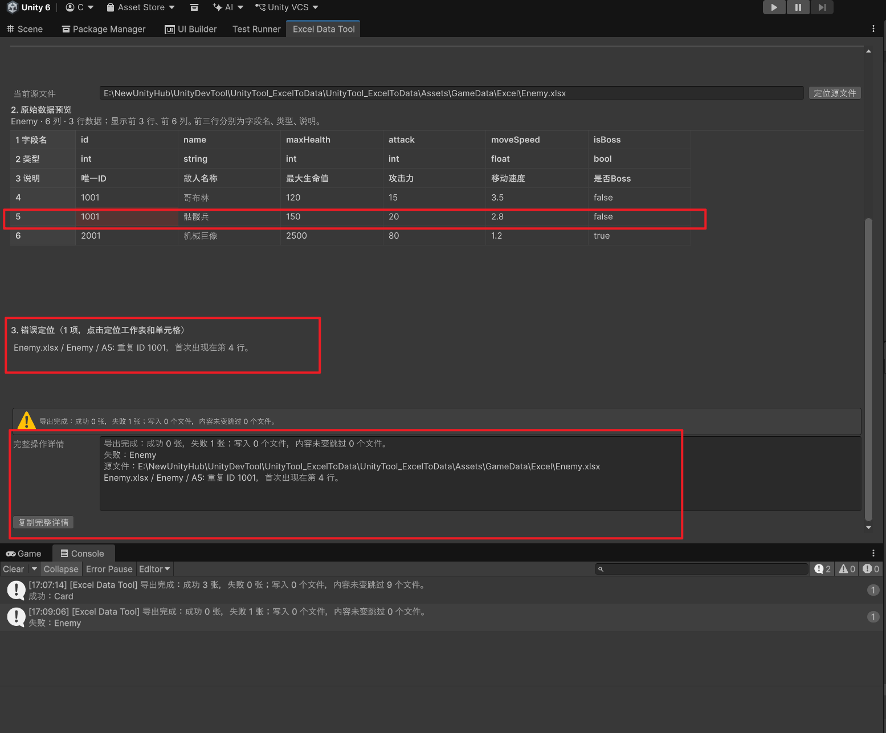

# UnityTool_ExcelToData：策划导表使用手册

在 Excel 中填写敌人、卡牌、道具等配置，再用这个工具把表格转换成游戏需要的文件。你不需要写代码；日常工作就是 **改表、保存、检查、导出**。

本文先说明 Excel 应该怎样填写，再带你打开已经装好工具的 Unity 项目。首次安装由负责项目的同事按 [安装说明](Docs/Installation.md) 完成；程序接入、迁移和测试说明见 [开发者文档](Docs/DeveloperGuide.md)。

## 一、先把 Excel 填对

### 1. 文件和底部标签是两回事

**工作簿**就是一个 Excel 文件，例如 `Enemy.xlsx`。**工作表**是文件底部的一个标签，例如 `Enemy`。一个文件可以有多个标签，工具会把每个有效标签分别导出。

新建示例时，把底部的 `Sheet1` 或“工作表1”标签重命名为 **`Enemy`**：通常双击标签名即可修改，也可以右键标签后选择“重命名”。仅把文件改名为 `Enemy.xlsx`，不会自动改变标签名。

工作表名称请使用同事约定的英文名称，例如 `Enemy`、`Card`、`Item`，首字母大写，不加空格或中文标点。两个来源文件不能同时包含同名的有效工作表。需要写使用说明时，可以新建 `#说明` 标签；以 `#` 开头的标签不会导出。

已有项目中的表名、字段名和字段类型，请保持与程序同事约定的一致。需要增加字段或改名时，先让负责数据接入的同事确认。

### 2. 前三行是表头，第 4 行开始才是数据

| Excel 行号 | 这一行填什么 | 怎么理解 |
|---|---|---|
| 第 1 行 | 字段名，例如 `id`、`name`、`maxHealth` | 每一列的英文名字，交给游戏识别 |
| 第 2 行 | 类型，例如 `int`、`string`、`bool` | 这一列允许填什么样的值 |
| 第 3 行 | 中文说明，例如“唯一ID”“敌人名称” | 方便人阅读，可以留空 |
| 第 4 行及以后 | 实际配置数据 | 每一行是一条记录，例如一个敌人 |

不要在表格上方再插入“敌人配置表”等大标题，也不要合并配置区域中的单元格。请从 **A1** 开始填写。

第 1 行的字段名以小写英文字母开头，后面只用英文字母、数字或下划线，例如 `maxHealth`；不要用中文、空格或重复的字段名。沿用模板中的名字最方便。

### 3. 可以照着填写的 Enemy 示例

把工作表标签命名为 `Enemy`，然后按下面内容填写。下表中 `id` 所在的一行就是 Excel **第 1 行**；`1001` 所在的一行是 **第 4 行**。

| id | name | maxHealth | attack | moveSpeed | isBoss |
|---|---|---|---|---|---|
| int | string | int | int | float | bool |
| 唯一ID | 敌人名称 | 最大生命值 | 攻击力 | 移动速度 | 是否Boss |
| 1001 | 哥布林 | 120 | 15 | 3.5 | false |
| 1002 | 骷髅兵 | 150 | 20 | 2.8 | false |
| 2001 | 机械巨像 | 2500 | 80 | 1.2 | true |

可以直接使用同事提供的 `Enemy.xlsx` 模板。填写完成后按 **Ctrl + S** 保存；新建文件请选择 **Excel 工作簿（.xlsx）** 格式。不要保存成 `.xls` 或 `.csv`，也不要仅修改文件后缀冒充格式转换。

### 4. id 是每条记录的唯一编号

每张表都必须有一列叫 **`id`**，其第 2 行必须填写 **`int`**。

例如 `1001` 用来识别哥布林，`1002` 用来识别骷髅兵。同一张表里不能给两条记录相同的编号，ID 也不能留空。已有记录的 ID 可能已被游戏里的其他内容引用，日常调整数值时不要顺手改 ID。

新增敌人时，在末尾增加一行，填写一个尚未使用的 ID，再补齐其他列即可；不需要另外建一张工作表。

### 5. 五种类型和空值规则

第 2 行的类型只能填写下面五种小写单词。

| 类型 | 填什么 | 正确例子 | 注意事项 |
|---|---|---|---|
| `int` | 整数 | `100`、`0`、`-5` | 不能填 `3.5`、`100点`，不能留空 |
| `float` | 小数或整数 | `3.5`、`1` | 不能填 `3,5`、`约3.5`，不能留空 |
| `double` | 项目要求更高精度的数字 | `0.125`、`30.5` | 不能填文字，不能留空 |
| `bool` | 是或否 | `true` 表示是，`false` 表示否 | 不能填 `是`、`否`、`1`、`0`，不能留空 |
| `string` | 文字 | `哥布林`、`普通敌人` | 可以留空；保留中文内容 |

布尔值也接受表格软件自身的 TRUE/FALSE 布尔格。数字的小数点使用英文句点 `.`，不要带单位；数字过大也会被判为错误。

**只有 `string` 数据格允许留空。** 数字和布尔格都要填值，`0`、`false` 与空白是不同的含义。整行全部为空时会跳过；只填了一半的记录仍然会检查缺失内容。

日常维护建议使用直接填写的值。使用公式时，工具只能读取表格软件保存的计算结果；出现“缓存缺失”时，先在表格软件中重新计算并保存，再回来检查。

## 二、在 Unity 中导出表格

下面假设同事已经为你安装好 Unity 和导表工具，并告诉你应打开哪个项目。

### 1. 打开同事提供的项目

1. 打开 **Unity Hub**，进入 **Projects（项目）** 列表。
2. 点击同事提供的项目。如果列表里没有，使用 **Add → Add project from disk（从磁盘添加项目）**，选择项目根文件夹，也就是里面能看到 `Assets`、`Packages` 和 `ProjectSettings` 的那一层。
3. 等待 Unity 窗口打开，等待首次加载或导入完成。Hub 若提示缺少编辑器版本，请按同事的安装说明处理；本工具使用的版本是 **Unity 6.3 LTS / 6000.3.17f1**。

Unity Hub 的添加入口也可参照 [官方项目窗口说明](https://docs.unity.com/en-us/hub/projects-window-reference)。

**导表全程在编辑状态下完成，无需点击顶部的 ▶ Play（播放）按钮。**

### 2. 打开导表窗口

在 Unity 顶部菜单点击 **Tools → Excel Data Tool**。

如果没有这个菜单，或 Unity 底部一直显示红色报错，把情况告诉负责安装的同事，先按 [安装说明](Docs/Installation.md) 检查工具是否装好。

### 3. 添加你要处理的 Excel

点击 **添加文件…**，找到已经保存的 `.xlsx` 文件并选中。还要处理其他文件时，再点一次添加即可。

如果同事已经把一整个文件夹设为配置来源，直接使用现有来源列表。**添加目录…** 会读取该目录及子目录中的 Excel；不要把存放大量历史备份的总目录加入来源，以免旧表与正式表重名。

导入了模板包的项目，也可以点击 **添加示例**，加入 Enemy 和 Card 模板。

### 4. 校验并看一眼预览

点击 **扫描并校验**，然后在中间列表单击要查看的工作表，例如 `Enemy.xlsx / Enemy`。

先核对三件事：选中的是正确文件和标签；数据行数符合预期；刚修改的数字在预览里已经更新。正常条目会显示“校验通过”；有问题时，下方错误列表会列出位置和原因。

预览显示前三行表头和前 **100 条非空数据、最多 30 列**。表格更大时仍会检查全部已读取内容；超出预览范围的错误也会显示具体坐标。

### 5. 选择导出范围

| 按钮 | 什么时候用 |
|---|---|
| **导出当前表** | 只导出列表中当前选中的那张工作表 |
| **批量导出** | 导出来源列表中的所有有效工作表 |

工具在每次导出前都会重新读取文件。表格有错时，那张表不会覆盖上一次的有效结果；批量导出时，其他没有错误的表仍然可以成功，所以要同时查看**成功数和失败数**。

“写入”表示文件新增或有变化；“跳过”表示内容与上次一样，不需要重复写入。**跳过不是报错。** 如果只是重导一次没改过的表，看到“写入 0”是正常的。

首次配置时，请让负责安装的同事确认输出目录和“生成命名空间”。这些设置会记住；日常改表沿用项目设置即可，不必修改。

### 6. 找到结果并交付同事

Unity 的 **Project（项目）** 窗口通常位于界面下方，用来浏览项目文件。默认结果在：

- `Assets → GameData → Generated → Json`：例如 `Enemy.json`，存放导出的数据。
- `Assets → GameData → Generated → Code`：例如 `EnemyRow.cs`、`EnemyTable.cs`，供程序使用。

如果项目使用了不同目录，以工具下方“完整操作详情”显示的路径为准。找不到 Project 窗口时，可以让同事帮你恢复布局；无需打开或编辑这些生成文件来完成导表。

交付时说明“改了哪个表、哪个 ID、哪些字段”，并按团队约定同步 **Excel 源文件和导出结果**。需要同事排查时，点击 **复制完整详情**，把文字一并发给对方。项目中的 `.meta` 和工具自动维护的文件请一起保留，不要自行删除。

## 三、日常改一次数字怎么做

例如把哥布林的最大生命值从 `120` 改为 `150`：

1. 打开 `Enemy.xlsx`，切换到底部 `Enemy` 标签。
2. 找到 `id = 1001` 的那一行，把 `maxHealth` 改成 `150`。在上面的示例里，这个格子是 **C4**。
3. 按 **Ctrl + S** 保存，回到 Unity，点击 **扫描并校验**，确认预览已显示 `150`。
4. 选中 Enemy，点击 **导出当前表**，确认成功后同步给同事。

在已有一次成功导出的前提下，只改数字、没有改字段或项目设置时，通常会看到 **写入 1 个文件、跳过 2 个文件**：更新的是 `Enemy.json`，两个 C# 文件不用改。

继续维护 Excel 源表即可。手工修改工具生成的 JSON 或 C# 会触发文件保护，影响后续导出。

## 四、出错时先看文件、标签和格子

例如错误提示：`Enemy.xlsx / Enemy / A5：重复 ID 1001`。

- `Enemy.xlsx`：要检查的文件。
- `Enemy`：文件底部的工作表标签。
- `A5`：A 列、第 5 行，即示例中第二条敌人的 ID。

如果 A4 和 A5 都填成了 `1001`，就会发生这个错误。应核对第二条记录正确的编号；按本页示例，A5 应为 `1002`。修改后保存，再扫描和导出。

可以直接点击错误列表中的这条消息，工具会切到相应表并高亮该格。错误格超过预览范围时，会告诉你准确地址，回 Excel 找到它即可。**修复前旧的有效导出数据会保留，错误数据不会替换它。**

| 遇到的情况 | 可以先做什么 |
|---|---|
| 提示重复 ID | 按错误坐标核对编号，同一张表每条记录使用不同 ID；保存后重试。 |
| 提示不能转换成 `int` / `float` 等类型 | 检查该格是否留空、带单位或填成了文字。整数列不要填小数；按第 2 行类型修正数据。 |
| 提示同名工作表冲突 | 检查来源中是否加了备份文件。选中不需要的来源，点“移除选中来源”；这不会删除文件。两张正式表确实同名时，请和程序同事确认名称。 |
| 文件被占用、无法读取或正在保存 | 先确认表格已保存完成，必要时关闭占用该文件的表格软件，再扫描；不要选文件名以 `~$` 开头的临时文件。 |
| 保存后预览还是旧数字 | 确认编辑的是列表中同一路径的文件，并已按 Ctrl + S；然后重新扫描。可用“定位源文件”查看实际位置。 |
| “添加示例”说文件不存在 | 请同事导入模板包，或直接用“添加文件…”选择自己的 `.xlsx`。 |
| 提示已有文件被修改、缺少归属记录或路径冲突 | 保留文件，把“完整操作详情”发给负责工具的同事处理；不要删文件或改目录来尝试绕过。 |
| 校验通过但游戏中还没变化 | 导出负责生成配置文件，游戏如何重新加载由项目决定；把导出结果交给程序同事确认。 |

## 下载和首次安装

发布后请到本仓库的 [Releases 下载页](https://github.com/CoKiEz/UnityTool_ExcelToData/releases) 获取发行包。计划的 **v1.0.0** 文件如下；是否已有可下载版本，以 Releases 页面实际显示为准。

| 文件 | 用途 |
|---|---|
| `ExcelDataTool-1.0.0.unitypackage` | 工具本体、运行时读取辅助、简明文档及许可证说明，由负责项目的同事安装 |
| `ExcelDataTool-Templates-1.0.0.unitypackage` | Enemy / Card 的 Excel 源表模板及 MIT 许可，可选导入 |

模板包不带别的项目已经导出的结果或管理记录，在新项目里需要自己校验、导出。已经拿到同事配置好的项目时，直接按本文使用即可。安装步骤、依赖和更新说明见 [安装说明](Docs/Installation.md)。

## 其他说明

- 技术接入、迁移、运行时示例和测试：[开发者文档](Docs/DeveloperGuide.md)。
- 实际验证记录与测试证据：[开发报告](Docs/DevelopmentReport.md)。
- 后续补充文档图片：[截图清单](Docs/ScreenshotGuide.md)。当前文档没有使用未提供的示意截图。
- 本项目自有代码采用 [MIT 许可证](LICENSE)，Copyright © 2026 CoKiEz。Unity 和其他第三方组件保留各自许可证，详见 [第三方说明](Docs/ThirdPartyNotices.md)。
